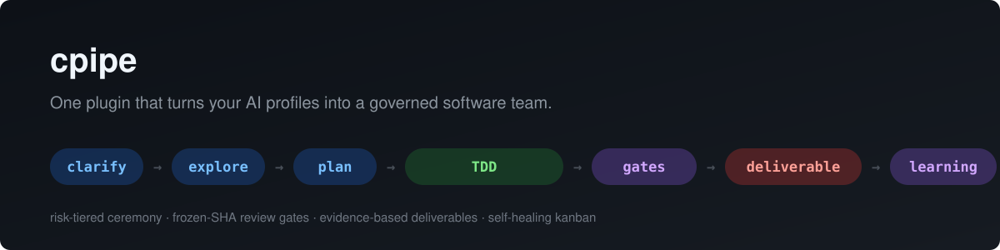

<p align="center">
  
</p>

# cpipe

[](https://github.com/chryzxc/cpipe/actions/workflows/ci.yml)
[](LICENSE)
[](https://github.com/NousResearch/hermes-agent)

**A [Hermes Agent](https://github.com/NousResearch/hermes-agent) plugin that turns your bots into a delivery team.** You ask for a change in chat; cpipe puts it on the Kanban board as a graph of cards (map → plan → build → review → verify), routes each card to one of your profiles, checks every step's evidence with code instead of trusting the bot, and ends with a tested draft PR for you to merge.

You bring the bots (your Hermes profiles, models and personas). cpipe decides which role gets each card, what the card asks for, and what has to be true before it moves on.

## How a request flows

```
you ─► coordinator ─► delivery_submit
                          │
        content:  build ──────────────────────────────► review ─► PR
        small:    build ─────────────────┬──────────► review ─┐
        large:    map ─► plan ─► build ──┘   verify ◄─(starts beside review)
                                               │
                     pass on approved commit ──┴──► PR marked ready ─► you test and merge
                     fail during review ─────────► back to that review round
                     fail after approval ────────► fix ─► verify again (2 rounds, then you decide)
```

- **content** (text, copy, styles, docs, config values): one card, no plan, no tests.
- **small** (one area): the implementer plans inline (CHANGE + PINS + RED), builds with TDD, then a verify card runs.
- **large** (crosses UI → API → DB, auth, persistence, jobs, or several packages): a cheap investigator maps the code, a frontier planner writes the plan, then build and verify.
- **fix** (`fix_of`): one fix card on the same branch when you report a problem.
- **design** (`design: true`): three parallel HTML mockups (closest to the app, your references, a fresh take). Your pick (`delivery_design_pick`) starts the build.

Every card runs in the request's own git worktree and sees only its brief plus its parent's result, never the chat, so sessions stay small.

## It's a graph, not a script

The flows are data in `cpipe/submit.py`:

- **`FLOWS`**: the steps of each flow (role, brief, runtime, workspace). Each card is tagged with its flow and step (`workflow_template_id`, `current_step_key`), so `hermes kanban list --step-key verify` works and every gate matches the tag, not the title.
- **`EDGES`**: (step, outcome) → next action. On every dispatcher tick, `cpipe/checks.py` reads how each verify ended and follows its edge. Bots never route work themselves.
- **`DELIVERY: <first card>`**: every later card names its delivery, so fix rounds are counted per delivery and the loop is bounded.

A test (`tests/test_flows.py`) fails if any step has no edge out.

## The ideas behind it

| Concept | Where it shows up |
|---|---|
| **Agentic graph** | Steps are nodes and outcomes are edges (`FLOWS`, `EDGES`). Code picks the next step from each card's result; the LLM only does the work inside a node |
| **Loop engineering** | Closed loops, each bounded: RED → GREEN inside a build; review → rework (2 rounds); verify → fix → verify (2 rounds); the monitor's sense → repair every 5 minutes. When a loop hits its limit, it stops and asks you |
| **Orchestrator–worker** | The coordinator routes and reports, never implements. Workers are short-lived sessions of your profiles, one per card |
| **Evidence-based gating** | `pre_tool_call` gates refuse a step without its proof (RED line, `CALLERS CHECKED`, `VERDICT`). Missing evidence blocks; it never passes |
| **Deterministic first** | Routing, monitoring, retries, triage and the delivery chat are scripts and hooks that cost no tokens. The LLM wakes only for judgment |
| **Sized ceremony** | Process scales with blast radius: content skips plan and tests, large gets a mapped, reviewed plan |
| **Context isolation** | Each card sees its brief and its parent's result, never the chat, in its own worktree |
| **Kanban pull** | The Hermes dispatcher pulls ready cards within per-profile caps. Children start when their parents finish |
| **Learning loop** | Weekly, `board_intelligence.py` counts review finding classes; any class seen 3+ times in 28 days becomes a drafted standards amendment for you to approve. `python3 -m cpipe.outcomes` reads how each delivery went (review rounds, fix rounds, verify fails, fixes you had to send); a failure repeated across deliveries of one project becomes a drafted lesson, and the lessons you approve in `~/.hermes/delivery/lessons.yaml` are stamped into that project's next cards. `python3 -m cpipe.brief_replay` re-runs past map/plan cards with today's briefs to show whether a change made them cheaper |
| **Human in the loop** | You are a node in the graph: at the fix-round limit the delivery chat asks you (one more round or stop, via `delivery_decide`), and a design pick starts the build. Merge, deploy and credentials stay yours |

## What each step must prove

| Step | Evidence checked by code |
|---|---|
| Plan | Pins for every caller behavior the change could break (tests of today's behavior, green on the old code), and a COMPLETE FEATURE line: what a careful senior ships without being asked |
| Build | A RED test before the fix, then GREEN. The implementer can't complete its own card: a gate sends it to review. Your linters (`quality.yaml`) run first on the changed files |
| Review | Same card, frozen commit, a `CALLERS CHECKED` list. Two rounds of changes, then you decide |
| Verify | Its own detached checkout. PROOF (the new tests fail at the merge-base), RELATED (tests of every changed file), SUITE (the repo's CI commands). Must end `VERDICT: PASS\|FAIL <sha>`. Platform changes (CI, Docker, migrations, lockfiles) go to the release engineer |
| PR | Draft until verify passes on the approved commit. Text and commits are scanned for local paths, card ids and bot names before they go public |

## Keeping the board moving

The board is watched by scripts that read the task database, worker processes and GitHub, not the bots' messages:

- **Delivery monitor** (every 5 min) gives every open card one verdict: `PROGRESSING`, `WAITING(<thing>)` or `STUCK(<cause>)`. It repairs known causes (dead worker, stale guard, quota wall) and escalates the rest once, with the next step. It starts in `observe` mode; set `monitor_mode: act` in `~/.hermes/delivery/config.yaml` to let it repair.
- **Board triage** (every 20 min) retries cards that only hit a rate limit or crash, and sends you a digest: *needs your decision / looks done / parked*. Reply `continue <id> …`, `archive <id>` or `resubmit <id>`.
- **Stall supervisor** (every 15 min) wakes the LLM only when its scan output changes.
- **Delivery chat**: each delivery gets its own conversation (`⛓ <request>`) with one line per board event, written straight from the board at no token cost.
- **Mission Control**: a `hermes dashboard` tab with the same queue.
- **ESTOP**: `~/.hermes/ESTOP` pauses the dispatcher and every cron job; `hermes resume` restarts them.

## Install

Requires a working Hermes Agent with at least one profile.

```sh
git clone https://github.com/chryzxc/cpipe.git && cd cpipe
./install.sh --roster coordinator=default implementer=forge reviewer=sentry verifier=sentinel security_reviewer=cypher
hermes gateway restart
```

Or use the one-liner, which asks the 5 role questions: `bash <(curl -fsSL https://raw.githubusercontent.com/chryzxc/cpipe/main/bootstrap.sh)`.
To update, run `git pull && ./install.sh`. It never touches the Hermes engine, so `hermes update` keeps it.

`install.sh` links the plugin and skills, copies the scripts and cron jobs, and copies the example bots from `workflow/bots/` into the mapped profiles (backing up what it replaces; `SKIP_BOTS=1` keeps yours). Roles map to profiles in `~/.hermes/roster.yaml`: 5 required, the rest alias automatically, so 3 profiles work.

**What you set per profile:** the model (frontier for planner and reviewer, cheap is fine for investigator, implementer and verifier), the persona (`SOUL.md`, which must not contradict the card briefs), and toolsets.

**Optional per-project files** in `~/.hermes/delivery/`:

```yaml
# projects.yaml: stamped into every card of that project
projects:
  my-app: { base_branch: develop, branch_prefix: feat/, conventions: "draft PR at the first pushable commit" }

# quality.yaml: your checks before review, your guidance per role
checks:
  - { name: lint, files: "*.ts *.vue", run: "npx eslint --max-warnings=0 {files}" }
guidance:
  reviewer: "Also check loading, empty and error states."

# lessons.yaml: approved lessons, the newest 10 go on every card of the project ("*": all projects)
my-app:
  - { text: "Run `prisma generate` before the tests", added: 2026-10-05 }
```

## Tools and commands

| Tool | What it does |
|---|---|
| `delivery_submit` | Turns a request into its flow's cards and subscribes the chat |
| `delivery_design_pick` | Starts the build from a chosen design |
| `delivery_decide` | Your answer when a delivery stops at the fix-round limit: one more round, or stop and finish the PR yourself |
| `delivery_status` | Each open card's verdict, from the database |
| `delivery_watch` | Waits on a PR or CI run; required before anyone says a card "will resume" |
| `delivery_test_env` | Runs a branch with the project's saved test recipe and returns the URLs |
| `delivery_verify_failed` | Manual fallback; failed verifies are routed by the graph |
| `delivery_mutation_check` | Flips one condition in a throwaway worktree and requires a test to fail |
| `delivery_check_policy`, `delivery_board_intelligence` | Config drift check; per-stage times, queue waits, rework rates |

From the terminal: `hermes cpipe` (doctor), `hermes cpipe status [--card ID]`, `hermes cpipe log --card ID` (that card's full story from `~/.hermes/logs/delivery-journal.jsonl`).

## Repo map

```
cpipe/submit.py        flows, edges, card briefs, delivery_submit
cpipe/checks.py        verify beside review, outcome → edge routing
cpipe/review_gate.py   review, verdict and round-limit gates
cpipe/card_gate.py     card creation, public-text and plan-budget gates
cpipe/flow.py          per-delivery chat
cpipe/status.py        verdicts, watches, chat hooks
cpipe/outcomes.py      how each delivery went, lesson candidates
workflow/bots/         example personas and role skills
workflow/scripts/      monitor, triage, supervisor, housekeeping, audits
workflow/cron.jobs.json, config.assertions.yaml, roster.example.yaml
dashboard/             Mission Control tab
```

Safety: tools only create cards and subscriptions. Merge, deploy, credentials and anything irreversible stay with you.

## Contributing

```sh
uv run --no-project --with "pytest>=8,<9" --with pyyaml python -m pytest -q
```

[MIT](LICENSE) © 2026 Christian Rey Villablanca
