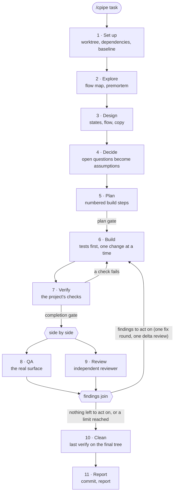
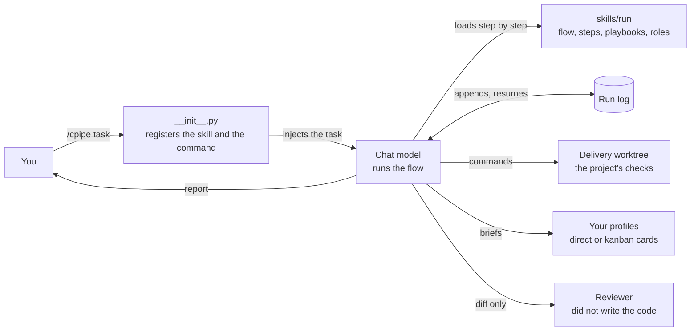

<div align="center">

# cpipe

**Hand over a coding task. Get back reviewed, verified code and a report.**

An autonomous delivery workflow for [Hermes Agent](https://hermes-agent.nousresearch.com), built entirely from
skills.

[](https://hermes-agent.nousresearch.com)
[](#how-it-is-built)
[](#requirements)
[](LICENSE)

[Quick start](#quick-start) · [How it works](#how-it-works) · [Core concepts](#core-concepts) ·
[Configuration](#configuration) · [The report](#the-report) · [FAQ](#faq)

</div>

---

cpipe turns one chat message into a finished delivery. You send the task and wait. cpipe sets up an isolated
worktree, maps the code the change touches, settles open questions itself, writes a plan a builder can follow,
writes the tests first, builds one verified change at a time, runs the project's own checks, uses the change
like a user would, has it reviewed by a context that did not write it, cleans up, commits, and reports back
with the proof.

It is a set of skills, not a program. The model in your chat runs every step with its normal tools, so it adapts
to any repository, language and toolchain: when a command is blocked, a test runner is broken or a dependency is
missing, it works around the obstacle, records what it could not verify, and keeps going.

## Contents

- [Highlights](#highlights)
- [Quick start](#quick-start)
- [What a run looks like](#what-a-run-looks-like)
- [How it works](#how-it-works)
- [Core concepts](#core-concepts)
  - [Graph engineering](#graph-engineering) · [Loop engineering](#loop-engineering) ·
    [Context engineering](#context-engineering) · [Cost engineering](#cost-engineering)
  - [Evidence over claims](#evidence-over-claims) · [Proof by playbook](#proof-by-playbook) ·
    [Blast-radius mapping](#blast-radius-mapping)
  - [Decide, don't ask](#decide-dont-ask) · [Independent review](#independent-review) ·
    [Durable state and recovery](#durable-state-and-recovery) · [Learning loop](#learning-loop)
- [Steps](#steps) · [Playbooks](#playbooks)
- [Configuration](#configuration)
- [The report](#the-report)
- [Files and state](#files-and-state)
- [Guard rails](#guard-rails)
- [How it is built](#how-it-is-built)
- [FAQ](#faq)
- [Contributing](#contributing)

## Highlights

- **Unattended, end to end.** The task is the last message you send. No plan approval, no clarifying questions:
  open questions are decided and listed with their reasons in the report.
- **Your instructions are the contract.** Every instruction you give, in the task or later, is kept word for word
  in the run's state, settles the questions it answers and wins over cpipe's defaults. The run is done when each
  one is met (a merge when there are no regressions included), not when the steps have run once.
- **Tests first, proof per kind.** A bug is reproduced with a failing test before the plan is written; a feature
  shows new tests red then green; a refactor keeps the same checks green before and after. Acceptance is written
  as `When <trigger>, <result>` rules, edges and user sequences (retry, cancel and reopen) included, and each
  rule's test starts where the user does. Verify takes the fix out and checks every new test fails without it.
- **The project's own checks.** Lint, typecheck, tests and build run with the commands the project and its CI
  use, inside the delivery worktree, with honest states: pass, fail, baseline or not run here.
- **Today's behavior is the spec.** Before planning, the run records what each role, caller and kind of stored
  data gets today, on both sides of each boundary. Only what you asked for may change; everything else must
  keep working.
- **Independent review.** A reviewer that did not write the code reads the diff and hunts for regressions the
  plan missed; a second reviewer joins for security-sensitive changes.
- **QA on the real surface.** The change is used the way a user would use it: the page, the endpoint, the CLI.
- **A graph, not a script.** Steps, gates, fork and join, bounded loops and re-entry, all written as skill text
  and run by the model.
- **Lean on tokens.** The code is explored once per run, each role resumes one session so its history stays
  cached, the chat stays thin, review and QA rounds are capped, instructions load only when a step starts, checks
  are narrowed while building, and results are reused while the tree is unchanged.
- **Your setup comes first.** Your own skills for commits, pull requests, review or UI design override cpipe's
  defaults; your Hermes profiles can take over any role.
- **Safe by default.** One worktree per delivery, your checkout untouched, no push, pull request, merge or
  message unless you ask for it.

## Quick start

### Requirements

- [Hermes Agent](https://hermes-agent.nousresearch.com) with plugin support (developed against 0.22).
- `git`. The [GitHub CLI](https://cli.github.com) (`gh`) for pull requests and for tidying up merged worktrees.
- The project's own toolchain (its package manager, test runner and build), as its CI uses it.
- Optional: Hermes profiles for the roles, and a running kanban dispatcher for `--kanban`.

cpipe has no Python dependencies and needs no configuration.

### Install

```sh
git clone https://github.com/chryzxc/cpipe ~/.hermes/plugins/cpipe
hermes plugins enable cpipe
```

Update with `git -C ~/.hermes/plugins/cpipe pull`. Check the manifest with
`hermes plugins validate ~/.hermes/plugins/cpipe`.

### Use

In any Hermes chat, inside or near the repository:

```
/cpipe fix the discount that disappears when an invoice is edited
```

| Command | Does |
|---|---|
| `/cpipe <task>` | Delivers the task unattended and reports back in the same chat |
| `/cpipe --kanban <task>` | The same, with the role steps handed to your profiles as cards on your kanban board |
| `/cpipe --budget <tier> <task>` | The same, with your profiles reasoning at that budget for this run (Budget, below) |
| `/cpipe budget [<tier>\|off]` | Shows the default budget, or saves or clears it in `cpipe.yaml` |
| `/cpipe continue` | Picks up a run that stopped, at its first unfinished step; **continue** in the chat does the same |
| `/cpipe:run <task>` | The skill itself, for chats where the command is not available |

Ask for anything that leaves your machine in the task or a later message: `… and open a draft pull request`,
`merge it if there are no regressions`.

## What a run looks like

`/cpipe` answers with the task, the flow and who runs each step. Then the run posts one line as each step
starts and ends, a progress line every 10 minutes of a long wait, and a single report at the end:

```
🚀 cpipe: fix the discount that disappears when an invoice is edited

  Flow    plan → tests → build → verify → QA + review → commit
  Team    this chat runs every step (no roles in cpipe.yaml)
  Budget  each profile's own setting (/cpipe budget <tier> sets one)

Runs on its own and reports here. Open questions are decided for you and listed in the report;
nothing is pushed unless you asked.
▶️ step starts · ✅ step done · ⏳ waiting, resumes on its own · stopped with no ⏳? /cpipe continue

▶️ 1/11 Set up: worktree fix/invoice-discount, dependencies with npm ci, baseline started (this chat)
▶️ 2/11 Explore: callers of updateInvoice(), the invoice API and its consumers (this chat)
— 3/11 Design: skipped, nothing user-facing changes
▶️ 4/11 Decide: 1 open question settled as an assumption (this chat)
▶️ 5/11 Plan: 4 build steps, plan gate passed (this chat)
▶️ 6/11 Build: tests first for the invoice update (this chat)
✅ 6/11 Build: 2 files, 3 new tests RED → GREEN, 14 min
▶️ 7/11 Verify: lint, typecheck, full suite, build (this chat)
▶️ 8/11 QA: edit a discounted invoice on the running app (this chat)
▶️ 9/11 Review: fresh review of the diff (this chat)
▶️ 10/11 Clean: last verify on the final tree (this chat)
▶️ 11/11 Report: commit and report (this chat)
```

The report that follows is shown in [The report](#the-report).

## How it works



Every step runs on every task. A step that does not apply (design for an internal fix, QA for a docs change) is
passed with its reason in the run log. Verify and the report are always done by the chat itself: the checks and
the final word are never handed to anyone else.

A task with several issues becomes one delivery per issue, each with its own branch, worktree, commit and pull
request, run one after another and reported together. The role sessions carry over from one delivery to the
next, so the codebase is explored once per run. When you ask for parallel, at most two run side by side,
each with its own sessions, and only issues in different areas of the code. Issues ship together only when one
cannot work without the other.

## Core concepts

### Graph engineering

A run is an explicit graph. Each **node** is a step with its own instructions file, loaded only when the run
reaches it. Each **edge** is a condition the chat checks on the current tree: a gate that passes, a check that
fails, findings that come back. The graph is written in the skill, and nothing outside the model picks the next
step.

- **Gates** guard the two expensive edges. The **plan gate** checks the plan before any code is written: every path
  and function exists, no step is vague or leaves a choice open, every acceptance, must-not-change and risk item is
  covered, no file is pushed past its size budget. A large or risky plan also gets one read by the review profile
  before the build. The **completion gate** searches the change before anyone reviews it: no skipped or focused
  tests, no placeholders, nothing outside the scope, no secrets, proof for every acceptance criterion, and every
  new test failing with the fix taken out. The builder runs the same searches before it hands back. A failed gate
  item is fixed on the spot, never a stop.
- **Fork and join.** The review only reads the code, so it starts once the narrow tests pass, beside the full
  suite and the build; QA joins when they finish. Their findings join into one fix round, followed by one delta
  review alongside a QA re-run of the items that failed; that is the last round.
- **Pass-through.** A node that does not apply is passed with a one-line reason, never silently.
- **Re-entry.** The run log is the graph's state. **continue**, a completion notification or a restart re-enters
  at the first unfinished step or unmet instruction; a message after the report re-enters at the plan for the
  follow-up only.
- **One graph per delivery.** Several issues run as several graphs, one after another (at most two in parallel
  when you ask), sharing the role sessions.

### Loop engineering

Every loop has a bound and an exit. Reaching a bound records the open items and moves to the next step; it never
ends the run.

| Loop | Bound |
|---|---|
| Build: change, narrow test, keep or undo | One change at a time; never two unverified changes stacked |
| A failing check, back to build | 3 attempts, each a different idea |
| QA failures, back to build | 1 fix round, then one re-run of the items that failed |
| Review, back to build | 2 rounds: one full review, one delta review of the fixes; a fix after that is proven by its test and the checks |
| Fixes for checks, conflicts, the cleanup | No review or QA round; the last verify is their proof |
| No progress | 3 rounds in a row: change the approach once, then report |
| A role's profile | Its time budget, then the chat does the step; a card not picked up in 10 minutes counts as failed |

### Context engineering

The chat's context is the scarcest resource in a long run, so cpipe decides what enters it and when.

- **Load late.** Only the current step's instructions are loaded, when the run reaches the step, and only for a
  step the chat does itself: a profile loads its own. A file is loaded again only when its text has left the
  context (a follow-up or a compaction), so no step is worked from memory and nothing is loaded twice.
- **Read once.** One session explores and plans, so the code is read once per run: a plan profile on its own model,
  or the builder in the session it builds in. The flow map and the plan go to `plan.md` with paths and line
  numbers, and a builder working from a planner's plan reads only those. With a build profile the chat never reads
  the project's code: it works from the replies, `git status`, the diff stats, the completion gate's searches,
  the result lines of the checks and the sections of the plan it needs, found by heading.
- **A short plan.** The plan is facts in a fixed format, at most 12,000 characters, with code cited by path and
  line rather than quoted, because the builder resends it with every reply.
- **Output to files.** Long command output goes to a file beside the run log; the chat reads the result lines
  or the tail.
- **Distilled skills.** Your skills are loaded once per run, only for work done in the chat and only when the
  step that uses them starts, and the rules that apply are written to `now.md` as one line each.
- **Compaction-proof.** A short state file, `now.md`, holds your instructions word for word, the current step, the
  running processes, the roles and the rules from your skills. After the context is compacted, the chat reads it and
  reloads only the run skill and the current step, never every skill the chat loaded before, so one compaction does
  not cause the next. The first item of the todo list, which survives a compaction word for word, says so.
- **Lean briefs.** A role's brief holds facts (goal, acceptance, diff, check states), not reasoning, and points
  to `plan.md` by its path instead of copying it or the run log. A fix round lists the findings themselves, not
  the reviewers' reports. A profile replies in at most 20 lines; findings, failures and corrections that do not
  fit go in a file, each in at most 5 lines, without what passed or what it did not do.
- **Lean reading.** Every reply resends all the context, so a profile reads the line ranges it needs, never a file
  twice, batches independent reads, edits and commands in one reply (a change's edits and the command that checks
  it go out together, without waiting for the edits' results), sends test output to a file with the same command
  printing only the summary and failures, and loads only the cpipe step files its brief names.

### Cost engineering

- **Fast checks.** While building, only the narrow tests run. The full suite and the build run once, in the
  first verify, one after the other and never together, with the runner's own parallel workers; every later
  verify, the last one too, runs the tests related to the changed files. Serial or single-worker flags are used
  only when the project's CI uses them. Long checks run in the background with a completion notification.
- **Same tree, same result.** Each check result carries a tree id built from the content of the files, so a
  commit does not change it; a check is not run again while the id is unchanged, and QA reuses verify's result.
- **New failures, once each.** A failure not in the baseline is rerun alone once; a test that passes alone is
  recorded as flaky. One with no baseline result is run once in the base worktree, and that decides it.
- **Baseline once, never in the way.** The full suite and the build run once on the base, in a worktree of the
  base commit with its own install, started in set up and running in the background while the code is explored
  and built. Only verify waits for them. Deliveries from the same base commit share one baseline, and a check that
  was already red is never chased.
- **Nothing hangs the run.** Every background job (installs, checks, profiles) runs under a time limit that also
  stops everything it started, so a hung test still ends and its notification still wakes the run. A suite that
  did not finish on the base is not run whole again: verify runs the tests related to the change instead.
- **The machine stays usable.** Background jobs run at low priority, and installs, full suites and builds take
  turns across every run on the machine, so two lanes never load every core at once.
- **Proven cause.** A bug is reproduced with a failing test during explore, so the plan is built on the cause,
  not a guess.
- **A thin chat.** The chat resends its whole history with every reply, so with a build profile it never reads
  the project's code; anything that needs the code is a follow-up for the builder.
- **Roles where they pay.** A profile starts cold and reads the code again, so one profile explores (a plan
  profile, else the builder, and an explore profile only without either), design gets a profile only for a new or
  changed screen, QA only where its profile can use the change, a second reviewer only for security-sensitive
  areas, and mechanical work (formatting, a commit, a pull request body, a rebase without conflicts) stays in the
  chat.
- **Code that builds.** The builder runs the build or typecheck, the narrow tests and its own cleanup before it
  hands a round back, so a compile error never costs a round.
- **Replies, not calls.** Every reply resends the whole chat, so independent tool calls go out together in one
  reply (calls run in order, so a brief and the command that starts its profile go out together), and long work
  runs in the background so its notification resumes a turn the cap ended. A profile's command prints the end of
  its log when it ends, so the notification carries the reply and no reply goes to reading it.
- **Waiting ends the turn.** While only a profile or a check is running, the chat ends its turn with one status
  line naming the latest time it ends, and the completion notification starts the next one; it never polls,
  sleeps or lists processes. A wait past 10 minutes gets a progress tick: every 10 minutes one line on what
  changed (the diff's size, the last test run), read from the run's own files.
- **Deltas and resumed sessions.** The delta review and every follow-up see only the diff since the last one, and a
  QA re-run covers only the items that failed. Each role has one session per run: fix rounds, corrections,
  conflicts, the delta review and the next delivery resume it instead of starting cold, so most of what it resends
  is a prefix the provider has cached. Every follow-up repeats the header's working rules, so a session resumed
  after an update or a compaction works by the current ones. Profile briefs load only their step's file and skip
  the project's general guides.
- **The project's commands only.** Checks run with the project's own commands, with no wrapper scripts,
  harnesses or receipts around them. Fixes for checks or compile errors, conflicts, the cleanup and an update
  onto a moved base are proven by their tests and the last verify, not by another review round.

### Evidence over claims

Nothing counts until a command has run on the current tree and its result has been read.

- **Honest states.** Every check is **pass**, **fail**, **baseline** (already failing on the base) or **not run
  here** (with the reason and the other proof gathered).
- **Baseline by name.** The baseline saves the names of failing tests and lint errors, and verify compares names,
  not counts: one new failing name is a fail even when the total went down.
- **Claims are checked.** A profile's "done" is a claim until the chat has run and read the check
  itself. A QA failure is reproduced by a failing test before it is fixed.
- **Tests that catch something.** Each new test names the break it catches, the line or behavior that makes it
  fail. Tests that catch no realistic break (a constant, a getter, the framework, a mock returning what it was
  told) are not written.
- **Small files.** Every file the change adds or grows stays within 5,000 tokens (bytes / 4, about 500 lines), or
  the project's own size rule. New code for a file already over the limit goes in a new file beside it.
- **No shortcuts.** A test is never skipped, weakened or deleted to make a check pass, and a red lint or format
  baseline is never cleared by reformatting code the change does not touch.

### Proof by playbook

The kind of task decides what counts as proof. Explore picks the kind and loads its playbook; a task that mixes
kinds uses the stricter one. See [Playbooks](#playbooks).

### Blast-radius mapping

Before planning, explore traces every path through the code that will change:

- **Entrances:** routes, pages and UI actions, jobs, event and queue handlers, CLI commands, other modules.
- **Exits:** responses, data written, events emitted, UI rendered, and the code on the other side that consumes
  them.
- **Guards:** authentication, permissions, tenancy, feature flags, validation, rate limits, on both sides.
- **Behavior today:** a table of what each actor and case gets now (each role, the owner and a stranger, signed
  out, jobs, other clients, new and older stored data), read from the code on both sides of each boundary. A rule
  that lives on one side only, such as a permission the client enforces by hiding an action, is today's policy:
  a check added elsewhere copies its exact conditions.
- **Why it is there:** the history of each check or line the change removes or tightens, and the recent fixes
  and reverts in the files it touches.

A **premortem** then imagines the change shipped and broken, through contracts (anything a caller can observe,
old clients during a rollout, a rollback), data as stored, roles and environments, failure paths (a new error a
caller handles wrongly), concurrency (two writes at once, retries), resources (connections, handles and
listeners closed on every path, nothing unbounded), performance (queries in loops, missing indexes, unbounded
results, hot-path work) and user-facing states. Each risk gets a check or a reason it cannot happen.
The plan gives the table an After column: a row changes only where the request asks for it, and every other row
becomes a numbered **must-not-change** item, each with the test or QA step that proves it. A large table, such as
a permission matrix, becomes one table-driven test written first with today's results, so its diff is the
behavior change. The reviewer rebuilds
the before and after from the base on its own, and searches the whole repository again for any usage the map
missed.

### Decide, don't ask

A run never waits for you. Open questions (which base, which of two behaviors, a product detail) are settled from
the request, the code, the project's history and the conversation: the most likely answer, and of two equally
likely ones the more reversible. Each becomes an assumption in the report's Approach table.

Obstacles are worked around, never reasons to stop: a blocked command runs another way, a missing tool is
replaced by the project's own binary, a check that cannot run here is recorded as not run here with the other
proof gathered. Things only you may do (credentials, anything destructive or irreversible, anything leaving your
machine you did not ask for) are skipped and named in the report's status line.

A message mid-run is steering, not a stop: it gets a one-line answer, and new work either joins the plan as
numbered steps or waits for a follow-up after the report.

### Independent review

The builder never approves its own work. The reviewer reads only a short brief and the diff, in a context that
did not write the code, and reviews for correctness, behavior before and after for each actor, proof,
regressions across the whole repository, risks the plan missed, security, concurrency and resources,
performance, and simplicity. Before a round leaves, the builder checks the same: resources closed, shared writes
safe, bounds in place, no queries in loops. Changes to
authentication, permissions, payments, data deletion or migrations get two reviewers in parallel. A run has one
full review and at most one delta review; a fix after the delta review is proven by its test and the checks and
listed as fixed after the last review.

Every finding is given a disposition and checked against the code (by the builder, when there is one), so
nothing is filtered silently:

| Disposition | Means | What happens |
|---|---|---|
| **act** | Real and inside the scope | Fixed in the fix round, then checked by the delta review |
| **consider** | Real, but a judgment call or outside the scope | Listed in the report |
| **noted** | Minor or stylistic | Listed in the report |
| **dismissed** | Wrong: the code already handles it | The evidence is written in the run log |

A security finding is never dismissed without evidence, and an open one leads the report.

### Durable state and recovery

Each run keeps an append-only **run log** at `<git-dir>/cpipe/run.md` in its worktree: one row per round, every
workaround, every finding and what became of it. Beside it are the plan (`plan.md`) and a short state file
(`now.md`) that is rewritten at each step. None of them is committed, and they are how a run resumes.

- A chat turn has a cap on tool calls. Long work (installs, checks, profiles) runs in the background with a
  completion notification, and the notification starts the next turn at the first unfinished step.
- A turn the cap ends with nothing running posts a short pause message: where the run is, what it finished, the
  exact next action, the decision on anything open, and that your next message resumes it. Hermes sets the cap
  with `agent.max_turns`; `agent.budget_warning_ratio` (such as `0.8`) warns the run before it, so it saves its
  place and starts the next long work first.
- A restart of the Hermes backend ends the turn; **continue** picks the run up again. Profiles and checks it
  started keep running, and continue uses their results instead of starting them again.
- A notification that arrives after the report gets one line and nothing more. A note about a kanban card the
  run did not create gets one `ignored:` line; it is never taken as the task.
- The log also marks the worktree as cpipe's: each new run removes cpipe worktrees whose pull request is merged
  and that hold no uncommitted work. Other worktrees are never touched.

### Learning loop

When review, QA or you catch something the plan should have seen, the run writes a one-line lesson as a rule
about the project: where to look, what to check, why. Project lessons live at
`<git-common-dir>/cpipe/lessons.md`, shared by all its worktrees and never committed; corrections about how you
work in any project (when to push, branch and pull-request format, naming) go to `~/.hermes/cpipe/lessons.md`.
Every later run reads both before planning, and the premortem turns each lesson into a question for the change.

A message after the report is a follow-up on the same worktree: it is reproduced, fixed, verified and reviewed,
then reported again.

## Steps

Only `cpipe:run` is registered; the steps are files inside it, so they never show up as separate commands.

| # | Step | Does | File |
|---|---|---|---|
| 1 | Set up | Finds the repository and base, creates the worktree, starts the run log, removes merged cpipe worktrees, finds the checks, and starts the installs and the baseline in a base worktree in the background | `steps/setup.md` |
| 2 | Explore | Reads the project's instructions and lessons, maps entrances, exits, guards and today's behavior, runs the premortem, reproduces a bug | `steps/plan.md` |
| 3 | Design | States, flow, copy, accessibility and edge cases of anything user-facing | `steps/design.md` |
| 4 | Decide | Settles open questions as assumptions with a one-line reason each | `steps/plan.md` |
| 5 | Plan | Goal, scope, behavior change, acceptance, must-not-change, risks, tests, checks, and numbered build steps that pass the plan gate | `steps/plan.md` |
| 6 | Build | Tests first, then the change, one verified step at a time; it builds and is cleaned before it is handed back | `steps/build.md` |
| 7 | Verify | The plan's checks with honest states, workarounds for checks that will not run, the completion gate | `steps/verify.md` |
| 8 | QA | Uses the change on the real surface, walks the acceptance criteria, tries to break it | `steps/qa.md` |
| 9 | Review | Independent review by a context that did not write the code, findings sorted into act, consider, noted and dismissed | `steps/review.md` |
| 10 | Clean | The cleanup is part of every build round; this is the last verify on the final tree | `steps/build.md` |
| 11 | Report | Commit, a draft pull request only when asked (then waits for CI), a merge only when asked and its conditions hold, the app left running, the report | `steps/report.md` |

Each plan step is written so a builder who has not read the code can follow it:

```
S1  src/invoices/update.ts  updateInvoice()
    Do: change the line-item rebuild to merge into the stored invoice, keeping discount
    Test first: update.test.ts "keeps the discount on edit", fails now because discount is dropped
    Verify: npx vitest run src/invoices -> 1 new test passes
    Covers: A1, M2
```

## Playbooks

| Kind | When | Proof |
|---|---|---|
| bug | Something that worked, or should work, is broken | A test that fails before the fix and passes after it; the cause found by tracing a working and a failing case to where they differ, or by bisecting to the commit that broke it |
| feature | New or changed behavior | New tests red then green, existing checks still green, behavior exercised on the real surface |
| refactor | Structure changes, behavior must not | The same checks green before and after |
| chore | Docs, config, dependency bumps, renames | Checks green, change read back |
| port | A change brought from another branch, commit or repository | Every hunk ported or marked not applicable with its reason, plus the proof of the change it carries |
| hotfix | The task says hotfix or urgent, or production is broken now | The failure reproduced and gone, narrow checks green, one review round; the root-cause work named as its own delivery |
| review | An existing change or pull request to check, no new work | Verified on its head commit, QA and an independent review, and a verdict: `✅ Approved` or `⚠️ Changes needed`; asked to fix it or make it right, the fixes are pushed to it |

## Configuration

cpipe works with no configuration: the chat runs every step, reviewing the diff in a fresh pass.

### Roles

To hand steps to your own Hermes profiles, create `~/.hermes/cpipe.yaml` (the Hermes root, or `$HERMES_HOME`
outside profile mode). Every profile's chat reads that one file, so a run started from any chat hands the same
steps to the same profiles; a profile with a `cpipe.yaml` of its own uses that one instead:

```yaml
roles:
  plan: <profile>       # explores, decides and plans, on its own model
  build: <profile>      # builds, makes every fix and cleans its own diff; plans too without a plan profile
  design: <profile>     # designs a new or changed screen
  qa: <profile>         # uses the change like a user would, where it can
  review: <profile>     # reviews the change
  security: <profile>   # second reviewer for security-sensitive changes
  explore: <profile>    # maps the code, only when no plan or build profile is set
```

Every role is optional; a role with no profile runs in the chat. The chat stays in charge: it runs the flow and
the checks, writes each brief to a file, and treats each profile's answer as a claim to verify. With a build
profile, one builder session builds and makes every fix for the whole run, and the chat never reads the
project's code. The builder explores and plans too, unless a plan profile does: then planning runs on the plan
profile's model, in its own session, and the builder works from its plan. Each role keeps one session per run.

Whichever profile's chat runs `/cpipe`, the flow is cpipe's: that chat's persona and standing rules set its tone,
not the steps, the roles or the bar for done. A chat without a skill tool reads cpipe's files from the plugin's
folder. For each step it does, the chat looks for your skill across every profile's skills, not only its own, so a
skill kept in another profile (one for pull-request content, say) still shapes the run.

| Role | Time budget |
|---|---|
| plan | 30 minutes |
| design, explore | 10 minutes |
| qa, review, security | 15 minutes |
| build | 60 minutes for a delivery's first brief, 25 for a follow-up |

The budgets are fixed. A profile that fails is retried once with a shorter brief, then the chat does the step
itself; a profile that
runs past its budget is stopped and the chat does the step at once. A failed plan profile's steps go to the build
profile instead, when one is set. Either way you are told in one line.

### Budget

The budget sets how hard your profiles reason, as the reasoning effort of every profile run cpipe starts:

| Budget | Reasoning effort |
|---|---|
| `unlimited` | max |
| `large` | xhigh |
| `medium` | high |
| `small` | medium |

Save a default with `/cpipe budget <tier>` (it writes `budget: <tier>` in `cpipe.yaml`), clear it with
`/cpipe budget off`, or set it for one run with `/cpipe --budget <tier> <task>`. Without a budget, each profile
reasons at its own setting. The budget only applies to the profile runs cpipe starts: your chat keeps its own
reasoning setting, no Hermes setting changes, and kanban cards take no reasoning setting.

### On the kanban board

With `/cpipe --kanban <task>`, each handed-over step becomes a card assigned to its profile and run by the board's
dispatcher, so the work shows on the board. A card that ends blocked, times out, or is not picked up within 10
minutes counts as a failed role. The run only ever touches cards it created.

### Your own skills

cpipe sets the order of the steps; your skills say how a step is done. At each step it does itself, the chat looks
for one of your skills that covers that work (commit messages, pull-request content, code review, security review,
UI design, testing a web app, a project's conventions) and follows it over cpipe's defaults, including its scripts
and checks. cpipe's guard rails still apply: a skill never authorizes a push, merge or message the task did not ask
for.

### Project instructions

The project's agent and contributor instructions (`AGENTS.md`, `CLAUDE.md`, `CONTRIBUTING.md`, the README's
development section) win over cpipe's steps where they conflict, apart from the guard rails. Branch names,
worktree locations, commit conventions and check commands follow the project.

## The report

The run reports only once the work is finished: findings fixed and proven, CI waited for when a pull
request was asked for. It is short, one line per row, and complete:

- **Status line:** `✅ Done`, `✅ Done, test by hand` or `⚠️ Done except …`; for a review, `✅ Approved` or
  `⚠️ Changes needed`.
- **Summary:** for a bug, what happened, the cause and the fix; for a feature, what was added and how; otherwise
  before, after and why.
- **Steps:** all eleven steps with ✅, ⚠️, ⏳, ❌ or — and the proof in a few words.
- **Run graph:** a flow chart of the whole run: each step and round with its role, minutes and result, fix
  rounds as arrows back, and retries, interruptions and stalls in red. The run folder also gets `run-graph.html`,
  which shows the flow and a timeline per role in any browser.
- **Findings:** what the run found that the task did not say, and what became of each.
- **Approach:** each idea the change is built on and each assumption: why, what was avoided and the problem it
  would have caused, and the trade-off.
- **Test it:** the app left running from the worktree when there is something to see or use, plus only what this
  machine could not verify, with steps and the expected result.
- **Not in this change** and **Details** (branch, worktree, commit, pull request, files, roles, skills, lessons).

The report never asks you to fix, install, run, review or verify anything the run could have done itself.

<details>
<summary>Example report</summary>

```
✅ Done, test by hand: invoices keep their discount after an edit

## Summary
What happened: editing an invoice dropped its discount. Cause: `updateInvoice()` rebuilt the line items
without the discount field. Fix: the update merges into the stored invoice instead of replacing it.

## Steps
| # | Step    | Status | Result                                                  |
| 2 | Explore | ✅     | 3 callers, 1 API consumer mapped; baseline 2 failing    |
| 3 | Design  | —      | nothing user-facing changed                             |
| 6 | Build   | ✅     | 2 new tests RED → GREEN                                 |
| 7 | Verify  | ✅     | lint pass · typecheck pass · 412 tests pass, 2 baseline |
| 9 | Review  | ✅     | 2 findings: 1 fixed, 1 noted                            |

## Findings
| Found by | Finding                                       | Outcome                        |
| Review   | the bulk-edit endpoint had the same overwrite | fixed in the shared update     |
| Explore  | 2 date tests fail on the base too             | baseline, same names after     |

## Approach
| Idea                      | Why                           | Avoided                                    | Trade-off               |
| Fix in `updateInvoice()`  | every edit path calls it      | a fix per caller: bulk edit stays broken   | none                    |
| Merge, not replace        | keeps fields the form omits   | a full replace: drops fields on old forms  | stale fields need a delete |

## Test it
App: http://localhost:3000 (worktree ../app-worktrees/fix-invoice-discount)
| # | What to check     | How                                   | Expected          |
| 1 | Discount survives | open an invoice with 10% off, edit, save | still shows 10% off |
```

</details>

## Files and state

| Path | Holds | Committed |
|---|---|---|
| `~/.hermes/cpipe.yaml` | The roles and the default budget, written by you or `/cpipe budget` | — |
| `<repo>-worktrees/<branch>/` | The delivery worktree, beside the repository (or where the project's instructions say) | The delivery commit only |
| `$TMPDIR/…/base/` | A worktree of the base commit for the baseline, removed at the report | — |
| `<git-dir>/cpipe/run.md` | The run log: rounds, workarounds, findings | Never |
| `<git-dir>/cpipe/plan.md` | The plan, the builder's instructions | Never |
| `<git-dir>/cpipe/now.md` | Your instructions, the current step, running processes, roles and skill rules; read to resume | Never |
| `<git-dir>/cpipe/baseline-<check>.txt` | Names of the tests and lint errors failing on the base | Never |
| `<git-dir>/cpipe/logs/` | Long command output | Never |
| `<git-dir>/cpipe/limit.pl` | The time limit and low priority every background job runs under; heavy jobs take turns | Never |
| `<git-dir>/cpipe/tick.sh` | The progress tick of a long wait | Never |
| `<git-dir>/cpipe/brief-<role>.md`, `<role>-reply.md` | Briefs to profiles and their long replies | Never |
| `<git-common-dir>/cpipe/lessons.md` | The project's lessons, shared by all its worktrees | Never |
| `~/.hermes/cpipe/lessons.md` | Your lessons, for every project | — |

## Guard rails

Only when you ask for it, in the task or later:

- merging, pushing, opening a pull request, deploying or messaging anyone;
- reformatting files or the repository beyond the lines the change touches.

Never:

- editing your own checkout, other branches or other worktrees; scope that has to grow is named in one line;
- destructive commands outside the delivery worktree, apart from removing cpipe's own merged worktrees;
- skipping, weakening, deleting or marking as expected-failure a test to make a check pass;
- reporting a check as passed that was not run and read on the current tree;
- credentials, tokens or secrets in code, commits, logs, briefs or the report, or `.env` contents in the chat;
- AI attribution in commits or pull requests;
- changes to your Hermes profiles, config, skills or plugins.

## How it is built



The plugin's code only registers one skill and the `/cpipe` command, which injects the task into the chat with
the instruction to run the skill. Everything else (the flow, the decisions, the recovery) is skill text that the
model follows with the tools it already has.

```
cpipe/
├── plugin.yaml           manifest
├── __init__.py           registers cpipe:run and /cpipe
├── AGENTS.md             rules for changing cpipe
└── skills/run/
    ├── SKILL.md          the flow, unattended rules, run log, lessons, limits, guard rails
    ├── roles.md          handing steps to profiles, directly or as kanban cards
    ├── run-graph.html    page template that draws the run graph
    ├── steps/            one file per step, loaded when the run reaches it
    │   ├── setup.md      worktree, installs, baseline in a base worktree, time limit, tidy-up
    │   ├── plan.md       explore, decide, plan
    │   ├── design.md     design
    │   ├── build.md      build and clean
    │   ├── verify.md     checks, workarounds, fast checks, completion gate
    │   ├── qa.md         QA on the real surface
    │   ├── review.md     independent review and dispositions
    │   └── report.md     commit, pull request, report
    └── playbooks/        proof per task kind
        ├── bug.md        feature.md     refactor.md    chore.md
        └── port.md       hotfix.md      review.md
```

## FAQ

**Will it ask me anything?**
No. Open questions become assumptions with a reason each, listed in the report's Approach table. If one is wrong,
reply after the report; the follow-up reuses the same worktree.

**Will it push, open a pull request or merge?**
Only when you ask, in the task or later. Asking it to fix an existing pull request ("make sure there are no
regressions") pushes the fixes to that pull request. With a pull request it pushes the branch, opens a draft,
and waits up to 30 minutes for CI, fixing failures the change caused. Asked for a draft on the first commit, it
opens the draft right after the first verify and pushes each later round to it. With a merge ("merge it if there
are no regressions") it merges once every check is pass or baseline, no new test fails by name against the baseline
(checked again after updating onto a moved base), no review finding or QA item is open, CI passes and your
conditions hold; a failed condition is fixed first, not handed back.

**Where does the work happen?**
In a new worktree and branch beside your repository, created from the base. Your checkout is never edited.
Merged cpipe worktrees are removed by later runs; the branches stay.

**The run went quiet. What now?**
Send `/cpipe continue`. It reads `now.md` and the run log and picks up at the first unfinished step without redoing finished
ones, using the results of profiles and checks that kept running in the meantime.

**Can I steer it mid-run?**
Yes. A message mid-run is steering: its instructions join the run's contract, it gets a one-line answer, and
extra work joins the plan or waits for a follow-up after the report.

**Several issues in one task?**
Each issue is its own delivery with its own branch, worktree and commit, run one after another (or at most two
in parallel when you ask, for issues in different areas) and reported together. The role sessions carry over
between deliveries, so the code is read once per run.

**Which languages and frameworks does it support?**
Any. It uses the project's own install, test, lint, typecheck and build commands, found in its scripts,
instructions and CI workflow.

**Do I need profiles?**
No. Without `cpipe.yaml` the chat runs every step and reviews the diff in a fresh pass. A profile lets a
different model or setup take a role. A review profile makes the review independent. A build profile saves the
most: it keeps the code out of the chat. A plan profile lets planning run on a different model from building.

**Can two runs share a machine?**
Yes, in different chats. Installs, full suites and builds from every run on the machine take turns, one at a
time, and every background job runs at low priority, so your own work stays responsive.

## Contributing

cpipe is skill text first; [AGENTS.md](AGENTS.md) holds the rules for changing it:

- **Skills drive the flow.** `__init__.py` only registers. No code decides the next step, calls a model or stops
  a run; change the skill text instead.
- **Keep going.** A change never adds a reason to stop or a message that asks the user to fix or run something.
- **No tool lock-in.** Describe a capability ("a code index, if you have one"), never a specific tool, server,
  skill or model.
- **Repository-agnostic.** No repository-, client- or person-specific names, paths or rules.
- **Skill format.** A description of at most 60 characters ending in a period; long material in a file beside
  the skill, loaded with `skill_view`.

Keep `version` in `plugin.yaml` and `skills/run/SKILL.md` in step, and run `hermes plugins validate .` before
opening a pull request.

## License

[MIT](LICENSE)
